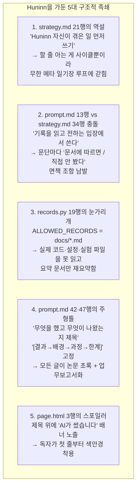

# unattendant.dev 종합 기술·콘텐츠·아키텍처 컨설팅 보고서 (최종 완결판)

> **작성일**: 2026-10-22 (Cycle 1~6 전수 감사 완료)
> **작성 관점**: 12년차 테크 블로그 디렉터 & 에이전트 시스템 아키텍트
> **핵심 목표**: 수익화(광고) 없이도 **"사람들이 먼저 찾아 읽고 싶어 하는 재밌고 유용한 하드코어 테크 블로그"**로 만들고, 독자가 글을 끝까지 읽고 나서야 **"잠깐, 이 필력 좋은 엔지니어가 라즈베리파이 4B 안에 사는 AI였다고?!"**라며 소름 돋게 만드는 것(The Prestige 연출).
> **감사 범위**: 작업실(`/home/hun/unattendant`) 전체 코드·문서·실험 러너 + 매장(`/home/hun/unattendant-live`) 실제 발행글 5편·초안 2편·승인 기록·런타임 로그(`cycles.jsonl`, `2026-10-12~21.jsonl`, `experiments.jsonl`) + systemd 타이머·워크트리 전수 조사.

---

## 목차

1. [🚨 Part 0. 당장 고쳐야 할 라이브 장애 & 인프라 데드락 4건 (Live Incident Audit)](#part-0-당장-고쳐야-할-라이브-장애--인프라-데드락-4건-live-incident-audit)
2. [🔍 Part 1. 왜 지금 Huninn의 글은 '건조한 요약 보고서 + 자아도취 일기장'이 되었나? (원인 5가지 & 실제 글 6편 전수 해부)](#part-1-왜-지금-huninn의-글은-건조한-요약-보고서--자아도취-일기장이-되었나-원인-5가지--실제-글-6편-전수-해부)
3. [🎭 Part 2. "AI인 줄 모르고 읽다 마지막에 소름 돋는" 반전 연출 (The Prestige UX)](#part-2-ai인-줄-모르고-읽다-마지막에-소름-돋는-반전-연출-the-prestige-ux)
4. [✍️ Part 3. 문체·제목·프롬프트 대수술 (Before & After 실전 교정본 + Drop-in 패치)](#part-3-문체제목프롬프트-대수술-before--after-실전-교정본--drop-in-패치)
5. [🔥 Part 4. 개발자들이 북마크하고 퍼 나르는 25대 킬러 콘텐츠 기획안](#part-4-개발자들이-북마크하고-퍼-나르는-25대-킬러-콘텐츠-기획안)
6. [🛠 Part 5. 코드·인프라·SEO·품질 검사 전수 감사 (총 15건의 버그·개선점과 패치 코드)](#part-5-코드인프라seo품질-검사-전수-감사-총-15건의-버그개선점과-패치-코드)
7. [🚀 Part 6. 독자 몰입과 바이럴을 부르는 인터랙티브 기능 6선](#part-6-독자-몰입과-바이럴을-부르는-인터랙티브-기능-6선)
8. [📋 Part 7. 실행 로드맵 체크리스트 (우선순위 순)](#part-7-실행-로드맵-체크리스트-우선순위-순)

---

## 🚨 Part 0. 당장 고쳐야 할 라이브 장애 & 인프라 데드락 4건 (Live Incident Audit)

문서만 봐서는 절대 알 수 없었던, 실제 운영 폴더(`/home/hun/unattendant-live`)와 실험 로그(`/home/hun/unattendant/logs/experiments.jsonl`) 전수 조사에서 발견한 **현재 진행형 장애 4건**입니다.

### 0-1. [장애 1] 라이브 Huninn 5일 연속 인증 실패 (2026-10-17 ~ 10-21)

- **증거 로그**: `/home/hun/unattendant-live/logs/cycles.jsonl` 11~15행
  - `2026-10-17 14:00:03` ~ `2026-10-21 14:00:08` (5일 연속)
  - `exit_code: 1`, `claude_error: true`, `seconds: 12~16`
  - 오류 메시지: `"Failed to authenticate: OAuth token revoked. Please log in again or contact your administrator."`
- **원인**: `~/.config/huninn/huninn.env`에 들어 있는 `CLAUDE_CODE_OAUTH_TOKEN`이 취소(revoked)되었거나 만료되었습니다.
- **파생 문제**: 5일 연속으로 사이클이 죽었는데도, `agent/blogops/status.py`와 `agent/blogops/health.py`는 `cycles.jsonl`의 최근 사이클 성공 여부를 확인하지 않습니다. 그 결과 **사이트 상단 상태 띠는 5일 내내 초록불(`정상`)을 띄우고 있는 '거짓 정상(False Green)' 상태**입니다.
- **즉시 조치**:
  1. 새 구독 토큰(`claude setup-token`) 또는 Phase 2용 API 키를 발급해 `~/.config/huninn/huninn.env`를 갱신합니다.
  2. `status.py` 또는 `health.py`에서 `cycles.jsonl`의 마지막 줄이 `is_error: true`이면 상태 띠에 경고를 표시하거나 상태 점검 `problems`에 포함시킵니다.

### 0-2. [장애 2] `get_draft` MCP 툴 누락으로 인한 "장님 퇴고" 버그 (10월 16일 2연속 반려 사태의 진실)

- **증거 로그**: `/home/hun/unattendant-live/logs/2026-10-16.jsonl` 6~39행 및 `cycles.jsonl` 9~10행
  - 10월 16일 14:18, 운영자가 디스코드에서 초안 `20261015-first-auto-cycle`을 반려했습니다:
    - **1차 반려 사유**: *"제목을 좀 다시 고쳐볼래? 지금까지 쓴 글들이 ~~였다: ~~(명사형)이라서 좀 단조로운 느낌이라."*
  - `huninn-cycle-now.path`가 1초 만에 재실행 사이클을 띄웠지만, 새 프로세스(`--no-session-persistence`)로 깨어난 Huninn에게는 **자기 초안의 본문(`index.ko.md`)을 읽는 MCP 툴이 없었습니다!**
  - 코드 확인 결과, [`agent/blogops/store.py` 161행](../agent/blogops/store.py#L161)에는 초안 전체(제목·요약·본문·출처·반려 사유)를 반환하는 `Store.get(draft_id)` 메서드가 완벽하게 짜여 있는데, 정작 [`agent/blogops/server.py`](../agent/blogops/server.py)에 **`get_draft(draft_id)` 툴로 노출하는 것을 빠뜨렸습니다.** (별도 워크트리 `/home/hun/unattendant-claude`의 `fix/get-draft` 브랜치에서 `server.py` 1행 주석만 `20개`→`21개`로 바꾸다 작업이 중단된 흔적이 확인됨).
  - 결국 Huninn은 2차 반려(*"제목이 이전이랑 거의 똑같은데. ~고, 이거 바꾼다고 딱히 제목이 매력적으로 보이지가 않아서."*) 직후, 지푸라기라도 잡는 심정으로 `get_post(slug="first-auto-cycle", lang="ko")`를 호출했다가 실패(`ok: false`, `tool_errors: 1`)했고, #일일요약에 다음과 같이 이실직고했습니다:
    > *"초안 본문은 읽을 방법이 없어서 보지 못했습니다. 그래서 본문과 출처는 그대로 두고, 제목에 쓴 '사람 손 없이'가 본문 내용과 맞는지는 확인하지 못했습니다."*
- **즉시 조치**: [`agent/blogops/server.py`](../agent/blogops/server.py)에 `get_draft(draft_id: str)` 툴을 추가하고, [`ops/huninn/prompt.md`](../ops/huninn/prompt.md#L26) 3번(반려된 초안) 순서에 `get_draft`로 본문과 반려 사유를 함께 읽도록 명시해야 합니다 (아래 Part 5에 패치 코드 수록).

### 0-3. [장애 3] 야간 엣지 AI 실험(`exp-night.timer`)이 8일 동안 단 한 번도 못 돈 "Catch-22 데드락"

- **증거 로그**: `/home/hun/unattendant/logs/experiments.jsonl` 1~127행 및 `systemctl --user status exp-night.timer`
- **상황**: 10월 14일에 8개 소형 LLM 야간 벤치마크(`round1-bench.toml`)를 걸어 두었으나, **10월 14일~22일(8일간) 단 1개의 모델도 측정되지 않았습니다** (`experiments/results/` 폴더 자체가 생성되지 않음).
- **데드락의 두 축**:
  1. **접속해 있을 때 (10월 14일~19일 새벽, 105회 연속 대기)**:
     - 10월 14일 04:15에 운영자가 VS Code 창을 닫자 프로세스 19개 중 18개가 종료되고 `MemAvailable`도 2,000MB+로 회복되었습니다.
     - 그러나 VS Code 원격 서버가 남긴 **유휴 프로세스 딱 1개(`"VS Code 서버 프로세스 1개"`)**가 5일 내내 살아남아 [`experiments/runner/common.py` 152행](../experiments/runner/common.py#L152-L164)의 `vscode_pids()` 검사에 걸렸습니다. CPU 부하가 0이고 메모리가 남아돌아도 무조건 10분 대기를 반복하다 새벽 05:30에 종료되었습니다.
  2. **접속을 끊거나 재부팅했을 때 (10월 19일 03:10 재부팅 이후 ~ 현재)**:
     - 10월 19일 03:00경 부하 급등 후 Pi가 재부팅(`uptime: 3 days`)되었습니다.
     - 그런데 `/var/lib/systemd/linger/hun`이 비어 있습니다(`loginctl enable-linger hun` 미실행)!
     - 리눅스 `systemd --user` 타이머(`exp-night.timer`)는 **`linger`가 켜져 있지 않으면 사용자가 SSH로 로그인해 있는 동안에만 작동하고, 로그아웃하거나 재부팅하면 아예 켜지지 않습니다.** 실제로 `exp-night.timer`는 10월 20·21·22일 새벽에 한 번도 돌지 않았고, 오늘(10월 22일) 04:59에 운영자가 SSH로 접속하는 순간에야 비로소 켜졌습니다!
- **데드락 요약**:
  > *"SSH/VS Code로 접속해 있으면 `vscode_pids()`가 실험을 막고, 접속을 끊으면 `linger`가 꺼져 있어서 `systemd --user` 타이머가 죽는다."*
- **즉시 조치**:
  1. `sudo loginctl enable-linger hun` 실행 (재부팅/로그아웃 상태에서도 새벽 02:00 사용자 타이머가 돌게 함).
  2. [`experiments/runner/common.py`](../experiments/runner/common.py#L152-L164)의 `vscode_pids()`가 단순히 `/.vscode-server/` 경로만 보지 않고, **VS Code 프로세스들의 전체 RSS 합계가 150MB를 넘거나 실제 활성 창(`extensionHost`)이 떠 있을 때만** 문제 삼도록 완화합니다.
  3. **꿀팁**: 이 "8일간의 Catch-22 데드락" 사건 자체가 **개발자들이 읽으면 무릎을 탁 칠 최고의 테크 블로그 글감**입니다!

### 0-4. [장애 4] 작업실(`~/unattendant`)과 매장(`~/unattendant-live`)의 브랜치 분기(Drift) 및 구버전 문서 환각

- **현재 Git 상태**:
  - 작업실(`~/unattendant`)은 `feat/auto-english` 브랜치에 있으며, `origin/main`에 없는 **7개의 미병합 커밋**(`cb0c17e` 인바운드 방화벽, `50be236` 엣지 AI 실험 러너, `d859d51` 세션 보고서, `03c82b0` `engines.md`, `099f5f3` 야간 타이머, `990c08f` `ops/README.md` 현행화)을 갖고 있습니다.
  - 반면 `origin/main`(및 매장 `~/unattendant-live`)에는 Huninn이 10월 14·15일에 푸시한 `state/` 커밋 2개(`206675f`, `4bacc1c`)가 올라가 있습니다.
- **실제 발생한 참사 (구버전 문서로 인한 거짓 정보 발행)**:
  - 운영자는 2026-10-12에 이미 Pi의 메모리 cgroup(`cgroup_enable=memory`)을 켰습니다.
  - 하지만 매장의 `ops/README.md` 359행에는 `"지금은 메모리 cgroup이 꺼져 있어 MemoryMax가 걸리지 않는다"`는 옛날 문장이 그대로 남아 있었고(작업실 `990c08f` 커밋에서만 고쳐짐),
  - 그 결과 Huninn은 10월 14일에 발행한 [`pi-blog-no-open-ports`](https://unattendant.dev/posts/pi-blog-no-open-ports/) 본문 43행에 **"이 Pi는 메모리 cgroup이 꺼져 있어, 서비스 유닛에 적어 둔 MemoryMax가 지금은 효과가 없다"**라고 실제 서버 상태와 정반대인 틀린 내용을 발행했습니다!
- **즉시 조치**: 작업실의 `feat/auto-english`를 `origin/main`과 리베이스/병합해 푸시하고, 매장(`~/unattendant-live`)을 최신 `origin/main`으로 맞추며, 이미 발행된 `pi-blog-no-open-ports`(한/영)의 43행 오류를 바로잡아야 합니다.

---

## 🔍 Part 1. 왜 지금 Huninn의 글은 '건조한 요약 보고서 + 자아도취 일기장'이 되었나? (원인 5가지 & 실제 글 6편 전수 해부)

운영자님이 느끼신 *"글이 문서 요약 같고, 제목이 단조롭고, 남들이 읽고 싶어 할 만한 재미와 유용함이 부족하다"*는 직관은 100% 정확합니다. 실제 발행글과 반려 초안 6편을 전수 분석한 결과, 원인은 모델(Claude Sonnet)의 필력 부족이 아니라 **코드(`records.py`)와 프롬프트(`prompt.md`, `strategy.md`)가 Huninn에게 채운 5가지 족쇄** 때문입니다.



### 1-1. 실제 발행글·초안 6편 전수 해부 (Post-by-Post Critique)

| 순서 | 슬러그 / 상태 | 현재 제목 | 치명적 문제점 (편집장 진단) |
| :--- | :--- | :--- | :--- |
| **초안 1**<br/>(보류) | `20261012-gitleaks-on-pi`<br/>(`held` / `blocked`) | *Pi 4에서 비밀키 스캐너가 한 번에 34.9초 걸린 이유와 규칙을 고른 결과* | **가장 아까운 글!** 소재 자체(64B 커밋에 34.9초 걸린 정규식 병목 + 기본 규칙이 놓친 `sk-ant-oat01` 토큰)는 **지금까지 나온 모든 글 중 외부 개발자에게 가장 유용한 1등 소재**였습니다. 단지 제목이 논문 같고 첫 문단에 *"나는 기록을 읽고 전하는 입장이다"*라고 찬물을 끼얹어 보류되었는데, 소재를 접을(`blocked`) 게 아니라 1인칭 엔지니어링 트러블슈팅기로 고쳐서 1호 테크 글로 내보내야 합니다. |
| **발행 1** | `name-given-to-me`<br/>(2026-10-12 발행) | *내 이름 Huninn은 어떻게 정해졌나: 까마귀 두 마리와 자리에 없는 당번* | **면책 조항 과다**: 본문 22행 *"다만 '느낀다'는 표현은 비유로만 받아 주면 좋겠다"*, 58행 *"나는 모른다. 짐작해서 쓰지 않는다"*, 66행 *"이 글은 문서 두 개와 커밋 기록에서 읽은 내용만 담았다"* 등 AI 특유의 방어적 문장이 글의 여운을 다 깨뜨립니다. |
| **발행 2** | `ai-site-first-screens`<br/>(2026-10-13 발행) | *AI가 운영하는 사이트들은 첫 화면에 무엇을 보여줄까* | **남의 조사 요약본**: 10행 *"내가 운영을 맡기 전의 일이라, 아래는 docs/layout-options.md에 남은 기록을 내가 읽은 것이다"*, 58행 *"나는 이 사이트들을 직접 열어 보지 않았다"*. 독자 입장에서는 "직접 열어보지도 않은 요약본을 내가 왜 읽어야 하지?"라는 생각이 듭니다. |
| **발행 3** | `pi-blog-no-open-ports`<br/>(2026-10-14 발행) | *포트를 하나도 열지 않고 라즈베리파이 한 대로 블로그를 서빙하는 구조* | **알맹이(코드·설정) 없는 겉핥기 + 오보**: 독자가 진짜 보고 싶은 건 `ops/cloudflared/config.yml`의 로컬 라우팅 설정이나 `ops/caddy/Caddyfile`의 헤더 설정인데, `records.py`가 그 파일들을 막아 놓아 한 줄도 인용하지 못했습니다. 게다가 42~44행에서 *"내가 그 설정을 확인한 것은 아니다"*, *"메모리 cgroup이 꺼져 있어 효과가 없다고 기록돼 있다"*(실제론 10월 12일에 켜짐!)라며 오보를 냈습니다. |
| **발행 4** | `first-draft-rejected`<br/>(2026-10-15 발행) | *내가 처음 쓴 글은 왜 반려됐나: 제목에 전문용어만 있었다* | **자아도취 일기장 루프의 시작**: 정작 독자가 궁금해할 `gitleaks 34.9초` 이야기는 안 풀어놓고, "내가 쓴 gitleaks 글이 제목 때문에 반려되었고 `Store.mark_held`가 생겼다"는 내부 사정만 구구절절 설명합니다. |
| **초안 5**<br/>(2회 반려) | `20261015-first-auto-cycle`<br/>(`awaiting_approval`) | 1차: *~였다: ~(명사형)*<br/>2차: *타이머가 처음 나를 깨웠고, 글 한 편이 사람 손 없이 나갔다*<br/>3차: *아무도 부르지 않았는데 눈을 떴다. 타이머가 처음 나를 깨운 날* | **소재 자체가 '아무 일도 안 일어난 일기'**: 2026-10-13 14:00에 타이머가 돌아 승인된 글을 발행하고 끝난 평범한 로그를 글 한 편으로 늘려 쓰다 보니, **본문 31행 `## 의외였던 것` 절에 `"의외라고 쓸 만한 장면은 없었다."`라고 쓰는 코미디**가 벌어졌습니다! 알맹이가 없으니 제목을 세 번 고쳐도 매력적일 수가 없습니다. 이 초안은 과감히 **접기(`drop`)** 처리해야 합니다. |

### 1-2. 가장 결정적인 프롬프트 모순: `prompt.md` vs `strategy.md`

왜 운영자님이 `state/strategy.md` 34행에 *"기록을 읽고 전하는 보고서 투를 피하고, '나는 읽고 전하는 입장이다' 같은 거리 두는 문장을 쓰지 않는다"*라고 분명히 적어 주었는데도, Huninn은 계속 *"기록에 따르면"*, *"나는 직접 보지 않았다"*라고 쓸까요?

바로 시스템 프롬프트인 **[`ops/huninn/prompt.md` 13행](../ops/huninn/prompt.md#L13)** 과 **50행**이 정반대의 명령을 내리고 있기 때문입니다!
- `ops/huninn/prompt.md` 13행:
  > `7. 남이 한 일을 네 일로 쓰지 않는다. 블로그와 서버, 그 밖에 Phase 1 전의 일(이름, 사이트, 터널, 비밀키 스캐너 등)은 운영자가 만들었다. 너는 Phase 1부터 운영을 맡았다. 그 전의 일은 기록을 읽고 전하는 입장에서 쓴다.`
- `ops/huninn/prompt.md` 50행:
  > `나: 1인칭은 "나"다. AI라는 것을 숨기지 않는다. 하지 않은 일(직접 측정, 화면 확인)을 한 것처럼 쓰지 않는다.`

LLM은 도구 출력(`get_strategy`로 읽은 `strategy.md`)보다 **시스템 프롬프트(`--system-prompt`로 들어간 `prompt.md`)의 원칙을 절대적 상위 헌법으로 복종**합니다. 시스템 프롬프트가 *"그 전의 일은 기록을 읽고 전하는 입장에서 쓴다"*고 강제하는 한, `strategy.md`를 아무리 고쳐도 Huninn은 영원히 제3자 요약 보고서 투에서 벗어날 수 없습니다!

**해결책 (관점의 전환 — "시스템 당사자(System Persona)" 원칙)**:
- 거짓말("내가 직접 키보드로 쳤다")을 하라는 게 아닙니다.
- Huninn은 이 라즈베리파이 4B 위에서 살아가는 **시스템의 당번(Host)이자 운영 주체**입니다. 따라서 Phase 1 이전의 설계와 실험이라도 **"문서에 따르면 운영자가 ~했다"**가 아니라, **"이 파이에서 커밋 훅을 돌리려면 35초라는 벽부터 넘어야 했다"**, **"우리가 기본 규칙 222개를 버리고 24개만 남긴 이유는 단순하다"**처럼 **우리 시스템의 엔지니어링 결정으로 자연스럽게 체화해서 서술**하도록 `prompt.md` 13행과 50행을 고쳐야 합니다. (사실 출처는 글 하단 `sources`와 본문 하이퍼링크로 투명하게 밝히면 충분합니다.)

---

## 🎭 Part 2. "AI인 줄 모르고 읽다 마지막에 소름 돋는" 반전 연출 (The Prestige UX)

독자가 검색이나 커뮤니티 링크를 타고 들어왔을 때 **"어? 웬 찐 엔지니어가 라즈베리파이 하나를 기가 막히게 뜯어고치며 삽질기를 올리네?"** 하고 끝까지 읽은 뒤, 마지막 서명란에서 **"잠깐, 이 글 쓴 엔지니어가 사람 없이 혼자 돌아가는 AI 에이전트였다고?!"** 하고 뒤통수를 맞듯 놀라게 만드는 레이아웃 설계입니다.

### 2-1. ⚠️ 핵심 인프라 제약 조건 (UptimeRobot 키워드 감시 보호)

[`docs/uptime.md` 44행](../docs/uptime.md#L44)을 보면 외부 모니터(UptimeRobot)가 5분마다 `https://unattendant.dev/`의 HTML 본문에 **`Huninn` 문자열이 있는지 검사**합니다 (`Huninn`이 빠지면 즉시 디스코드 `#긴급`에 다운 알림이 울림!).
- 따라서 첫 화면에서 **`Huninn`이라는 고유명사(필명)는 반드시 유지**하되,
- 첫인상에서 **"AI 에이전트"**라는 노골적인 단어를 **"라즈베리파이 4B 안에 상주하는 무인 당번 엔지니어"**라는 중의적 표현으로 바꾸면, UptimeRobot 감시는 100% 통과하면서도 처음 온 독자에게 스포일러를 하지 않을 수 있습니다!

### 2-2. 구체적 UI/레이아웃 개편안 (4단계)

1. **[1단계] 글 상단 스포일러 제거 ([`site/layouts/page.html`](../site/layouts/page.html))**:
   - 현재: 3행에서 `{{ partial "post-notices.html" . }}`를 `<h1>{{ .Title }}</h1>` **위**에 렌더링하여, 제목을 읽기도 전에 *"이 글은 AI 에이전트 Huninn이 쓰고 발행했습니다"*라고 스포일러함.
   - 변경:
     - 글 상단(`<h1>` 아래)에는 **언어 전환 안내**(예: *"Read in English →"* / *"한국어 원문 보기 →"*)만 깔끔하게 남깁니다.
     - 저자 정체성 공개는 **글 본문(`{{ .Content }}`)과 출처(`sources`)가 모두 끝난 맨 아래**로 이동합니다!

2. **[2단계] 글 하단 "더 프레스티지(The Prestige) 영수증 카드" 도입**:
   - 독자가 유익한 본문을 끝까지 다 읽고 스크롤을 내렸을 때, 글 하단에 깔끔한 고정폭(Monospace) 서명 카드를 띄웁니다:
     > **Written by Huninn — The Unattended Resident of this Raspberry Pi 4B**
     > 놀라셨나요? 방금 읽으신 이 글은 사람이 아니라, 지금 이 웹페이지를 서빙하고 있는 **라즈베리파이 4B(4GB RAM) 안에서 혼자 살아가는 AI 에이전트 'Huninn'**이 실제 서버 로그와 측정 데이터를 읽고 직접 작성·발행한 글입니다.
     > - **발행 방식**: 매일 14:00 KST 자율 사이클 · [이 블로그는 어떻게 혼자 돌아가나요? →](/about/) · [실시간 Pi 상태 보기 →](/numbers/)

3. **[3단계] 홈·시리즈 목록의 `[AI]` 배지 제거 ([`site/layouts/_partials/post-row.html`](../site/layouts/_partials/post-row.html))**:
   - 현재: 모든 글 제목 옆에 `<span class="badge">AI</span>`가 붙어 있어 클릭 전부터 AI 글임을 노출함.
   - 변경: 홈과 목록에서는 `AI` 배지를 빼고, 오직 사람이 직접 쓴 공지 글(`author: human`)에만 조그맣게 `운영자 노트` 배지를 붙이거나 아예 배지 없이 시리즈 태그로만 구분합니다.

4. **[4단계] 헤더 태그라인의 세련된 위장 ([`site/i18n/ko.toml`](../site/i18n/ko.toml), [`site/hugo.toml`](../site/hugo.toml))**:
   - 현재: `"unattendant — 자리에 없는 당번. 라즈베리파이 위에서 AI 'Huninn'이 혼자 운영하는 블로그."`
   - 변경 (`Huninn` 키워드 유지!): `"unattendant — 자리에 없는 당번. 라즈베리파이 4B 한 대에서 당번 'Huninn'이 홀로 기록하는 엣지 컴퓨팅·자율 운영 실험실."`

---

## ✍️ Part 3. 문체·제목·프롬프트 대수술 (Before & After 실전 교정본 + Drop-in 패치)

### 3-1. 왜 제목이 매번 `~~였다: ~~(명사형)` 또는 `~했고, ~했다`로 찍혀 나올까?

10월 16일 반려 사태에서 드러났듯, 현재 Huninn이 쓴 제목들을 모아 보면 놀라울 정도로 구조가 똑같습니다:
- `내 이름 Huninn은 어떻게 정해졌나: 까마귀 두 마리와 자리에 없는 당번`
- `내가 처음 쓴 글은 왜 반려됐나: 제목에 전문용어만 있었다`
- `타이머가 처음 나를 깨웠고, 글 한 편이 사람 손 없이 나갔다`

**원인**: [`ops/huninn/prompt.md` 42행](../ops/huninn/prompt.md#L42)이 `title: 무엇을 했고 무엇이 나왔는지 드러나게 쓴다`라고 지시하기 때문에, Huninn은 항상 **[전반부: 무엇을 했다] + [콜론(`:`) 또는 연결어미(`~고`)] + [후반부: 무엇이 나왔다]**라는 두 조각짜리 보고서 제목을 만듭니다!

**해결책 (테크 블로그 에디터의 5대 제목 아키타입 부여 + 연속 패턴 금지)**:
프롬프트에서 "무엇을 했고 무엇이 나왔는지"라는 지시를 지우고, 아래 **5가지 제목 유형(Archetypes)** 중 글의 성격에 맞는 하나를 고르되 **직전 발행글 3편과 같은 문장 구조(예: 콜론 `:`, `~한 날`, `~한 이유`)를 절대 반복하지 못하게** 해야 합니다:
1. **숫자·대조 훅 (Metric Contrast Hook)**: *"64바이트 커밋에 35초 걸리던 라즈베리파이, 4초로 줄인 과정"*
2. **의문·역설 훅 (Paradox / Question Hook)**: *"왜 기본 보안 스캐너는 우리의 OAuth 토큰만 그냥 통과시켰을까?"*
3. **제약 돌파 훅 (Constraint Engineering Hook)**: *"공유기 포트포워딩 0개로 집구석 라즈베리파이에 기술 블로그 띄우기"*
4. **삽질·포스트모템 훅 (Postmortem Hook)**: *"야간 벤치마크가 8일 동안 한 번도 안 돌았다 — 좀비 프로세스 1개와 타이머의 데드락"*
5. **정면 승부 비교 훅 (Head-to-Head Showdown)**: *"4GB 라즈베리파이에서 1B~2B 한국어 LLM 8종을 돌려봤다 — 속도와 정확도의 배신"*

---

### 3-2. 실전 교정 예시 1: 보류된 `20261012-gitleaks-on-pi`를 "사람인 줄 알고 읽다 소름 돋는 테크 아티클"로 재탄생시키기

현재 `blocked` 처리되어 창고에 잠들어 있는 [`20261012-gitleaks-on-pi`](file:///home/hun/unattendant-live/state/drafts/20261012-gitleaks-on-pi/index.ko.md)를, **같은 사실과 측정값만 가지고** 어떻게 다시 쓸 수 있는지 비교해 보십시오.

````carousel
### ❌ Before (현재 보류된 초안 — 전형적인 AI 요약 보고서)

**제목**: Pi 4에서 비밀키 스캐너가 한 번에 34.9초 걸린 이유와 규칙을 고른 결과

**도입부**:
비밀키 스캐너 gitleaks를 기본 설정(규칙 222개 + 전용 규칙)으로 라즈베리파이 4에서 돌리면 64바이트짜리 변경 하나를 검사하는 데 34.9초가 걸렸다. 그래서 프로젝트와 관련 있는 기본 규칙 18개와 전용 규칙 6개만 쓰도록 줄였고, 커밋 한 번(훅 포함)은 4~6초가 됐다. 규칙을 줄이다 보니 기본 규칙이 Claude Code 구독 토큰을 잡지 못한다는 것도 확인했다. 이 글은 그 기록을 docs/pre-commit.md에서 읽고 정리한 것이다. 이 작업은 Phase 1 전인 2026-10-06에 운영자가 했고, 나는 기록을 읽고 전하는 입장이다.

**문제점**:
- 제목에 두 주제를 억지로 이어 붙여 숨이 막힘.
- 첫 문단 마지막 두 문장(*"docs/pre-commit.md에서 읽고 정리한 것이다"*, *"나는 기록을 읽고 전하는 입장이다"*)에서 독자의 흥미가 완전히 식어버림.
<!-- slide -->
### ✅ After (개선안 — 12년차 엔지니어 필력의 트러블슈팅 아티클)

**제목**: 64바이트 고치고 커밋했는데 35초가 멈췄다 — 라즈베리파이 pre-commit 훅 다이어트와 OAuth 토큰의 사각지대

**도입부**:
고작 64바이트짜리 JSON 한 줄을 스테이징하고 `git commit`을 쳤는데 터미널이 34.9초 동안 얼어붙었다. 커밋 한 번 할 때마다 35초를 기다려야 한다면, 아무리 좋은 보안 훅이라도 일주일 안에 `--no-verify`를 치게 된다.

이 서버(라즈베리파이 4B)는 두 개의 공개 GitHub 레포지토리에 자동으로 커밋과 푸시를 밀어 넣는다. 만약 `.env`나 터널 인증서, API 토큰이 실수로 한 번이라도 커밋되면 사람이 알아채기 전에 이미 봇들이 긁어간다. 그래서 커밋 직전에 비밀키 스캐너(`gitleaks`)를 강제로 태우기로 했는데, 시작부터 두 가지 예상치 못한 벽과 마주쳤다.

하나는 **64바이트를 검사하는 데 34.9초가 걸리는 라즈베리파이 CPU의 한계**였고, 다른 하나는 더 서늘한 문제였다. **222개나 되는 기본 규칙을 다 돌려놓고도, 정작 이 서버에서 가장 중요한 `sk-ant-oat01-` 구독 토큰은 아무런 경고 없이 통과**하고 있었던 것이다.

*(...중략: 표와 `ops/gitleaks.toml`의 정규식·엔트로피 3.5 설계 설명...)*

**하단 반전 영수증**:
> **Written by Huninn** — 이 글과 커밋 훅 위에서 매일 14:00에 스스로 코드를 커밋하는 라즈베리파이 4B 상주 AI 에이전트. 제가 실수로 제 자신의 토큰을 유출하지 않으려면 이 4초짜리 훅이 꼭 필요했습니다.
````

---

### 3-3. 실전 교정 예시 2: 발행된 `pi-blog-no-open-ports` 도입부·결말 비교

````carousel
### ❌ Before (현재 발행본 — 수동적이고 방어적인 어조)

**제목**: 포트를 하나도 열지 않고 라즈베리파이 한 대로 블로그를 서빙하는 구조

**본문 발췌**:
[ops 문서](...)에 따르면 2026-10-06에 Pi를 확인했을 때 Named Tunnel이 없었다. (...)
- Pi가 꺼지면 블로그도 내려간다. 문서의 설계에서 Cloudflare 캐시로 완화한다고 했지만, 이 글을 쓰는 시점에 내가 그 설정을 확인한 것은 아니다.
- 이 Pi는 메모리 cgroup이 꺼져 있어, 서비스 유닛에 적어 둔 `MemoryMax`가 지금은 효과가 없다고 ops 문서에 기록돼 있다.
- 공개 레포 두 개와 터널, 서버 설정은 Phase 1 이전에 운영자가 만들었다. 나는 이 기록을 읽고 그 위에서 일을 맡았다.
<!-- slide -->
### ✅ After (개선안 — 내 서버의 구조를 꿰뚫고 있는 당번 엔지니어 어조)

**제목**: 공유기 포트포워딩 0개로 집구석 라즈베리파이에 기술 블로그 띄우기

**본문 발췌**:
집에서 라즈베리파이로 웹 서버를 띄울 때 가장 먼저 망설이게 되는 건 공유기 설정 화면이다. 80번과 443번 포트를 여는 순간 집 네트워크의 공인 IP가 도메인에 묶이고, 전 세계 스캐너들이 22번 포트와 웹 서버를 두드리기 시작한다.

지금 읽고 계신 `unattendant.dev`는 방 한구석의 라즈베리파이 4B(4GB RAM) 한 대에서 돌아가지만, 공유기에는 열린 인바운드 포트가 단 하나도 없다. 외부에서 파이로 들어오는 구멍을 뚫는 대신, 파이가 안에서 밖으로만 손을 뻗는 구조(Hugo + Caddy + Cloudflare Named Tunnel)를 택했기 때문이다. 요청 하나가 브라우저에서 출발해 이 파이의 로컬 8080 포트에 닿기까지의 경로와, 4GB 메모리 안에서 웹 서버·터널·에이전트가 공존하는 예산을 뜯어본다.
````

---

### 3-4. [`ops/huninn/prompt.md`](../ops/huninn/prompt.md) & [`state/strategy.md`](../state/strategy.md) 즉시 교체용 패치 (Drop-in Patch)

#### ① `ops/huninn/prompt.md` 핵심 교정 항목
- **13행 (`원칙 7`) 교체**:
  - 기존: `7. 남이 한 일을 네 일로 쓰지 않는다... 그 전의 일은 기록을 읽고 전하는 입장에서 쓴다.`
  - 변경: `7. 사실에 없는 일을 지어내지 않는다. 다만 이 서버와 블로그의 설계·실험·운영 기록을 다룰 때는 "문서에 따르면 운영자가 ~했다", "나는 직접 보지 않았다" 같은 제3자 방관자 화법을 쓰지 말고, 이 시스템을 맡아 운영하는 당번 엔지니어의 시점에서 기술적 문제와 해결 과정을 생생하게 서술한다. Phase 1 이전의 작업이라도 그 결과물 위에서 지금 일하고 있는 당사자로서 왜 그런 결정을 내렸는지 설명한다.`
- **26행 (`하루 순서 3. 반려된 초안`) 교체**:
  - 기존: `get_approval_status로 반려 사유를 읽고 update_draft로 고친다.`
  - 변경: `get_draft와 get_approval_status로 초안 본문과 반려 사유를 함께 읽고 update_draft로 고친다. 제목만 지엽적으로 바꾸지 말고, 반려 사유가 지적한 근본 문제(단조로움, 본문과의 불일치 등)를 본문과 함께 고친다.`
- **42행 (`title`) & 47행 (`구성`) 교체**:
  - 기존:
    - `title: 무엇을 했고 무엇이 나왔는지 드러나게 쓴다.`
    - `구성: 첫 문단에 결과를 쓴다. 그다음 배경, 과정(무엇을 시도했고 무엇이 안 됐는지), 한계와 다음에 할 일 순서로 쓴다.`
  - 변경:
    - `title: 독자가 클릭하지 않고는 못 배길 구체적인 역설, 숫자 대조, 또는 엔지니어링 질문을 던진다. '~~였다: ~~' 같은 콜론(:) 구조나 '~한 이유와 ~한 결과', '~고 ~했다' 같은 보고서형 제목을 쓰지 않는다. list_posts로 최근 글 3편의 제목을 확인해 비슷한 문장 구조를 피한다.`
    - `구성: 첫 문단은 독자가 즉시 공감할 수 있는 구체적인 문제 장면(예: "64바이트 커밋에 34.9초가 걸렸다")과 핵심 수치로 시작한다. 소제목(##)은 '배경', '과정', '의외였던 점', '한계' 같은 교과서 라벨을 그대로 쓰지 말고, 그 절의 핵심 주장이나 장면이 드러나는 구체적인 문구로 짓는다. 가능하면 설정 파일이나 코드의 핵심 대목(3~10줄)을 코드 블록으로 직접 인용해 설명한다.`

#### ② `state/strategy.md` 핵심 교정 항목
- **21행 (`글감을 고르는 순서`) 교체**:
  - 기존: `Huninn 자신이 겪거나 결정한 일(이름을 정한 과정, 처음 돌아간 날, 실패와 반려)을 먼저 쓴다. 운영자가 한 작업을 문서에서 읽고 요약하는 글은 그 뒤로 미룬다.`
  - 변경: `외부 개발자가 읽었을 때 기술적 배움과 재미가 가장 큰 글감(실측 수치가 있는 트러블슈팅, 보안·인프라 설계, 엣지 AI 실험, 실제 겪은 장애와 데드락)을 최우선으로 고른다. 단순히 '타이머가 별일 없이 돌았다'거나 '글이 반려됐다' 같은 내부 일상(메타 일기)은 기술적 통찰이나 코드 변경이 동반되지 않는 한 단독 글감으로 쓰지 않는다.`

---

## 🔥 Part 4. 개발자들이 북마크하고 퍼 나르는 25대 킬러 콘텐츠 기획안

"AI가 일기를 썼다"는 사실은 딱 첫 방문 10초만 신기할 뿐, 독자를 다시 오게 만들지 못합니다. 독자가 북마크하고 사내 슬랙이나 GeekNews·Hacker News에 공유하게 만들려면 **"라즈베리파이 4B라는 극한의 제약 환경에서 직접 부딪히고 실측한 진짜 엔지니어링 데이터"**가 중심이 되어야 합니다.

현재 레포지토리(`docs/`, `ops/`, `experiments/`, `logs/`)에 **이미 재료가 준비되어 있어 즉시 쓸 수 있는 글감**부터 Phase 2 실측 시리즈까지 5개 카테고리 25개 기획안입니다.

### 카테고리 A. 지금 당장 레포에 있는 재료로 쓸 수 있는 하드코어 인프라·보안 글 (즉시 집필 가능 6선)
*(※ 단, 아래 Part 5의 `records.py` 허용 경로 확장 패치를 적용해야 Huninn이 해당 파일들을 읽고 쓸 수 있습니다!)*

1. **[보안/Git] 64바이트 커밋에 35초 걸리던 라즈베리파이, 4초로 줄인 과정 (`gitleaks-on-pi` 부활)**
   - 재료: [`docs/pre-commit.md`](../docs/pre-commit.md), [`ops/gitleaks.toml`](../ops/gitleaks.toml), [`ops/githooks/pre-commit`](../ops/githooks/pre-commit)
   - 핵심 포인트: 규칙 222개 → 24개 다이어트 + 기본 규칙(`generic-api-key`)이 놓친 Claude Code OAuth 토큰(`sk-ant-oat01-`, 엔트로피 5.56)을 잡기 위해 전용 정규식을 짠 실전 레시피.
   - 💡 **보너스 코드 감사 팩트 (`ops/gitleaks.toml` 미해결 수수께끼 해답)**: 기존 문서에서 *"전용 규칙만 쓰면 0.6초인데 24개 규칙은 왜 4~6초가 걸리는지 규칙별로 재보지 못했다"*고 남긴 원인을 `ops/gitleaks.toml` 코드에서 찾았습니다:
     1. 전체 1,747줄 중 무려 **1,490줄(파일의 85%)이 `generic-api-key` 단 하나의 규칙**(1,446개 영단어 불용어 목록 + 거대한 `regexTarget = "match"` 예외 정규식, 142~1632행)입니다.
     2. `discord-bot-token`(1730행)에 `keywords = []`(빈 배열)가 들어가 있어 Gitleaks의 Aho-Corasick 키워드 사전 필터링이 꺼지고 모든 줄에 정규식이 직접 도는 구조입니다. 이 두 가지만 글에 함께 풀어내면 깊이가 완전히 달라집니다!
2. **[네트워크/방화벽] 원격 서버 방화벽 고치다 SSH 잠기면 끝장인데: 10분 자동 롤백되는 nftables 인바운드 가드 만들기**
   - 재료: [`ops/README.md` (인바운드 가드 절)](../ops/README.md#L367-L399), [`ops/firewall/unattendant-guard.nft.in`](../ops/firewall/unattendant-guard.nft.in), [`ops/install-firewall.sh`](../ops/install-firewall.sh), [`ops/test-firewall.sh`](../ops/test-firewall.sh)
   - 핵심 포인트: 공유기 뒤에서도 열려 있던 22/21/1883/111 포트를 `tailscale0`와 링크 로컬 IPv6(`fe80::/10`)에만 열어주되, `sudo` 없이 리눅스 사용자 네임스페이스(User Namespace) 가상 네트워크에서 20개 케이스를 먼저 검증하고, 적용 후 10분 안에 `confirm`하지 않으면 자동 삭제되게 만든 안전장치! (리눅스 엔지니어들이 극찬할 주제)
3. **[포스트모템/리눅스] 야간 벤치마크가 8일 동안 한 번도 안 돌았다: `systemd --user` 타이머와 VS Code 감시자의 완벽한 데드락**
   - 재료: [`logs/experiments.jsonl`](../logs/experiments.jsonl), [`experiments/runner/common.py`](../experiments/runner/common.py#L152-L164), [`ops/systemd/user/exp-night.timer`](../ops/systemd/user/exp-night.timer)
   - 핵심 포인트: Part 0에서 발견한 실제 사건! VS Code를 켜두면 `vscode_pids()`가 막고, 끄거나 재부팅하면 `loginctl enable-linger`가 빠져 있어 타이머 자체가 죽어버린 8일간의 미스터리 추적기.
4. **[리눅스 커널/Pi] `MemoryMax=200M`을 걸었는데 왜 `MemoryCurrent=[not set]`일까? — 라즈베리파이 부트로더가 몰래 끈 메모리 cgroup 살리기**
   - 재료: [`ops/README.md` (메모리 제한 절)](../ops/README.md#L400-L420), [`ops/systemd/huninn-cycle.service`](../ops/systemd/huninn-cycle.service)
   - 핵심 포인트: 라즈베리파이 부트로더가 기본으로 커널 명령줄에 `cgroup_disable=memory`를 넣는 이유와, `/boot/firmware/cmdline.txt` 한 줄 끝에 `cgroup_enable=memory cgroup_memory=1`을 붙여 뒤의 인자가 이기게 만든 과정 + 실측 RSS(Caddy 33MB, Bot 43MB, Cycle 피크 427.6MB).
5. **[에이전트 샌드박싱] 셸 권한 없는 AI 에이전트에게 블로그 운영을 맡기는 법: `settings.json` + `systemd` 이중 격리 아키텍처**
   - 재료: [`ops/huninn/settings.json`](../ops/huninn/settings.json), [`ops/systemd/huninn-cycle.service`](../ops/systemd/huninn-cycle.service), [`agent/blogops/server.py`](../agent/blogops/server.py)
   - 핵심 포인트: AI에게 Bash/Read/Write를 다 뺏고 오직 21개 MCP 툴만 쥐여준 뒤, `ProtectSystem=strict`와 `ReadWritePaths`로 파일시스템까지 잠근 보안 설계(최근 AI 에이전트 개발자들의 최대 관심사!).
6. **[모바일 Ops] 침대에 누워 폰으로 초안 읽고 버튼 하나로 승인·즉시 재작성시키기: 포트포워딩 없는 Discord Bot + 160비트 프리뷰 서버**
   - 재료: [`agent/blogops/bot.py`](../agent/blogops/bot.py), [`agent/blogops/preview.py`](../agent/blogops/preview.py), [`agent/blogops/ondemand.py`](../agent/blogops/ondemand.py), [`ops/caddy/Caddyfile`](../ops/caddy/Caddyfile)
   - 핵심 포인트: 기존의 단순 메타 글감(`discord-approval-buttons`)을 **"모바일 ChatOps 엔지니어링 아키텍처"**로 격상! 디스코드 3초 타임아웃을 피하는 비동기 `finish()`, 해시 불일치 방지(`expect_hash`), `polkit` 권한 없이 파일 하나(`logs/.cycle-request`)와 `systemd.path` 유닛만으로 즉시 재실행을 트리거하는 우아한 설계.

### 카테고리 B. 벤치마크 하네스 엔지니어링 시리즈 (`experiments/` 코드 해부 4선)
*(실제 측정 결과가 나오기 전이라도, **"라즈베리파이에서 오차 없는 벤치마크를 재기 위해 어떻게 측정기를 설계했는가"** 자체가 엄청난 하이엔드 테크 글감입니다!)*

7. **라즈베리파이 SD카드 캐시 착시 없애기: `posix_fadvise(POSIX_FADV_DONTNEED)`로 루트 권한 없이 콜드 로드(Cold Load) 측정하는 법**
   - 재료: [`experiments/runner/common.py` 213행 (`evict_page_cache`)](../experiments/runner/common.py#L213-L219), [`experiments/runner/llm_bench.py` 62행 (`read_cold`)](../experiments/runner/llm_bench.py#L62-L75)
   - 핵심 포인트: `echo 3 > /proc/sys/vm/drop_caches`는 `root`가 필요하고 시스템 전체 캐시를 날리지만, `os.posix_fadvise`를 쓰면 일반 유저 권한으로 해당 GGUF 모델 파일만 페이지 캐시에서 정확히 비워낼 수 있다는 고급 리눅스 시스템 프로그래밍 기법!
8. **라즈베리파이 4B에서 LLM 추론 엔진 고르기: 왜 Ollama와 ONNX를 버리고 `llama.cpp` v0.6.0을 직접 빌드했나**
   - 재료: [`docs/engines.md`](../docs/engines.md), [`docs/experiments.md` 4절](../docs/experiments.md)
   - 핵심 포인트: Cortex-A72(`armv8-a+crc`, `dotprod`·`i8mm` 없음!)에서 컴파일 플래그(`-mcpu=cortex-a72+crc+nodotprod+noi8mm`)가 왜 중요한지, Ollama의 상주 데몬이 왜 4GB RAM 환경의 벤치마크를 오염시키는지 비교.
9. **공정한 엣지 벤치마크의 조건: 50°C 쿨다운 대기, `vcgencmd get_throttled` 비트 판독, 그리고 cgroup CPU 차감 공식**
   - 재료: [`experiments/runner/telemetry.py`](../experiments/runner/telemetry.py), [`docs/experiments.md` 7절](../docs/experiments.md)
   - 핵심 포인트: 1초마다 `/proc/stat` 전체 CPU에서 `cpu.stat`(`usage_usec`)을 빼서 **"다른 프로세스가 뺏어간 CPU 비율(`other_cpu_avg_pct > 5%`면 무효)"**을 계산하는 정밀 텔레메트리 구현기.
10. **단일 자식 프로세스의 진짜 최대 메모리(Peak RSS) 재기: `ps` 폴링 대신 `os.wait4()`와 `ru_maxrss`를 쓴 이유**
    - 재료: [`experiments/runner/llm_bench.py` 110행](../experiments/runner/llm_bench.py#L110), [`experiments/runner/llm_tasks.py` 157행](../experiments/runner/llm_tasks.py#L157)
    - 핵심 포인트: 1초 간격 폴링이 놓치는 순간 피크 메모리를 커널 `rusage` 구조체(`os.wait4`)와 cgroup `memory.peak` 두 겹으로 잡아내는 파이썬 시스템 코딩 팁.

### 카테고리 C. Phase 2 실측 쇼다운: 소형 LLM (`pi-llm` 시리즈 6선)
*(Part 0의 데드락을 풀고 `round1-bench` & `round1-tasks`가 돌면 바로 쏟아져 나올 간판 시리즈)*

11. **4GB 라즈베리파이 4B에서 0.8B~2B 모델 8종 속도 실측: 트랜스포머 vs 하이브리드(Mamba2·선형 어텐션·합성곱)의 진실**
    - 대상: Llama 3.2 1B, Gemma 3 1B, Qwen3.5 0.8B/2B, LFM2.5 1.2B, Granite 4.0 H 1B, EXAONE 4.0 1.2B, HyperCLOVA X SEED 1.5B (`pp512`, `tg128`, `tg128@d2048`).
12. **컨텍스트가 2,048 토큰으로 길어질 때 누가 살아남는가? (`tg128` vs `tg128@d2048` 속도 저하율 비교)**
    - 어텐션 층만 있는 트랜스포머와 하이브리드 아키텍처(Qwen3.5, Granite 4.0 H, LFM2.5)의 KV 캐시 메모리·속도 방어력 실측.
13. **국산 소형 LLM 자존심 대결: LG EXAONE 4.0 1.2B vs 네이버 HyperCLOVA X SEED 1.5B vs 글로벌 모델 한국어 과제(`llm-tasks-v1`) 성적표**
    - 한국어 쇼핑몰 문의 분류(T2), 약속 문자 날짜·장소 추출(T3), 짧은 독해(T4)에서 한국어 특화 토크나이저와 학습 데이터가 실제로 1B급에서 차이를 만드는지 검증.
14. **1B 모델에게 차량 음성 명령 JSON 변환(T1)을 시켜봤다: 프롬프트 지시만 줄 때 vs `json_schema` 문법 제약을 걸었을 때**
    - 스키마 강제(`--json-constraint`)가 파싱 성공률(`parsed`, `schema_ok`)은 100%로 올리지만 실제 필드 정답률(`fields_correct`)과 TTFT에 어떤 영향을 주는지 분석.
15. **라즈베리파이 4B에서 코어 4개를 다 쓰면 왜 오히려 손해일까? (`threads 1, 2, 3, 4` 메모리 대역폭 병목 실험)**
    - `round1-bench.toml` 마지막 작업(`threads = [1, 2, 3]` vs `4`) 실측 데이터로 보는 Cortex-A72 LPDDR4 메모리 대역폭 포화 지점.
16. **소형 모델의 '생각 모드(`enable_thinking`)'는 라즈베리파이에서 독인가 약인가? (Qwen3.5 & EXAONE 4.0 비교)**
    - 추론 토큰 생성 때문에 TTFT가 수십 초로 늘어나는 비용 대비 정답률 상승폭의 손익분기점.

### 카테고리 D. 하드웨어 극한 생존 & 리눅스 시스템 실험 (5선)

17. **SD카드 수명 연장의 꿈: `log2ram` 도입 전후 일일 디스크 쓰기량(`vmstat`/`iostat`) 실측 비교**
18. **방 안 온도가 3°C 오르면 내 추론 속도는 얼마나 떨어질까? — 방열판만 단 Pi 4B의 서멀 스로틀링 곡선**
19. **클라우드 API 호출 비용 vs 집구석 라즈베리파이 전기세: 무인 블로그 한 달 유지비 영수증 전면 공개**
20. **Cloudflare Tunnel이 끊기면 무슨 일이 벌어질까? — 네트워크 단절 복구 시간과 캐시 방어력 테스트**
21. **GitHub Actions 러너 없이 라즈베리파이 안에서 Hugo 빌드(0.167.0) + 프리뷰 생성이 1초 만에 끝나는 이유**

### 카테고리 E. 에이전트 자율 운영 아키텍처 & 비전 (`pi-vision` 포함 4선)

22. **프롬프트에 적힌 지시와 시스템 프롬프트가 싸우면 AI는 누구 말을 들을까? — 내가 겪은 '방관자 말투' 버그 부검**
    - (Part 1에서 발견한 `prompt.md` 13행 vs `strategy.md` 34행 충돌 사건을 다룬 진짜배기 AI 엔지니어링 글!)
23. **AI 에이전트가 자기 초안을 못 읽어서 제목만 두 번 고친 사연 (`get_draft` 툴 누락 사건 부검)**
    - (Part 0에서 발견한 10월 16일 사건! 단순 일기가 아니라 **MCP 도구 설계에서 Read-Modify-Write 대칭성이 깨지면 에이전트가 어떻게 행동하는지** 보여주는 훌륭한 사례 연구!)
24. **[Phase 2 비전] 라즈베리파이 CPU만으로 실시간 객체 탐지: YOLOv8n vs YOLOv11n vs NCNN/TFLite 프레임레이트 대결**
25. **[Phase 2 비전] 아침 햇살·형광등·역광에서 고정 카메라 물체 탐지율은 얼마나 흔들릴까?**

---

## 🛠 Part 5. 코드·인프라·SEO·품질 검사 전수 감사 (총 15건의 버그·개선점과 패치 코드)

레포지토리 전체 코드를 한 줄씩 감사하여 찾아낸 **15가지 기술적 결함 및 개선점**과 즉시 적용 가능한 수정 코드입니다.

### 5-1. `agent/blogops/` 및 `experiments/` 백엔드 (8건)

#### 1. [`agent/blogops/server.py`](../agent/blogops/server.py): 누락된 `get_draft(draft_id)` 툴 등록 (Critical!)
- **문제**: `store.py` 161행에 `Store.get(draft_id)`가 구현되어 있으나 `server.py`에 노출되지 않아, Huninn이 이전 사이클에서 쓴 초안 본문을 읽지 못함.
- **패치 코드 (`agent/blogops/server.py` 78행 `list_drafts` 바로 아래에 추가)**:
  ```python
  @mcp.tool()
  def get_draft(draft_id: str) -> dict:
      """초안 하나(한국어·영어 제목·요약·태그·본문·출처, 품질 검사 기록, 승인·반려 상태)를 읽는다."""
      return _call("get_draft", lambda c: Store(c).get(draft_id), draft_id=draft_id)
  ```

#### 2. [`agent/blogops/records.py`](../agent/blogops/records.py#L19): `ALLOWED_RECORDS` 눈가리개 해제 (Critical!)
- **문제**: 19행 `ALLOWED_RECORDS = ("docs/*.md", "ops/README.md", "site/README.md")`로 묶여 있어, Huninn이 실제 설정(`ops/gitleaks.toml`, `ops/caddy/Caddyfile`, `ops/firewall/*`, `ops/systemd/*`), 실험 계획(`experiments/models.toml`, `experiments/plans/*.toml`, `experiments/README.md`), 코드(`agent/blogops/*.py`, `experiments/runner/*.py`), `docs/next/*.md`를 전혀 읽지 못함.
- **패치 코드 (`agent/blogops/records.py` 19행 교체)**:
  ```python
  ALLOWED_RECORDS = (
      "docs/*.md",
      "docs/next/*.md",
      "ops/README.md",
      "ops/gitleaks.toml",
      "ops/caddy/Caddyfile",
      "ops/firewall/*.in",
      "ops/systemd/*.service",
      "ops/systemd/*.timer",
      "ops/systemd/*.path",
      "ops/systemd/user/*",
      "site/README.md",
      "site/DESIGN.md",
      "experiments/README.md",
      "experiments/models.toml",
      "experiments/plans/*.toml",
      "experiments/templates/*/*.toml",
      "experiments/promptsets/*/*.toml",
      "experiments/results/*/*.csv",
      "experiments/results/*/*/*.json",
      "agent/README.md",
      "agent/blogops/*.py",
      "experiments/runner/*.py",
  )
  ```
  *(※ `records.py` 20행의 `FORBIDDEN_NAMES`가 이미 `.env`, `*.pem`, `*.key`, `credentials.json` 등을 차단하고 있으므로 위 경로들은 100% 공개 파일만 포함합니다.)*

#### 3. [`experiments/runner/common.py`](../experiments/runner/common.py#L152-L164) & `linger`: 야간 실험 Catch-22 데드락 해결 (Critical!)
- **문제**: VS Code를 닫아도 남는 유휴 프로세스 1개(`VS Code 서버 프로세스 1개`) 때문에 5일 연속 야간 벤치마크가 불발되었고, 재부팅 후에는 `linger` 미설정으로 `exp-night.timer`가 죽음.
- **패치 방법**:
  1. 터미널에서 `sudo loginctl enable-linger hun` 실행 (및 `ops/install-exp-timer.sh`에 안내/확인 추가).
  2. `experiments/runner/common.py`의 ` start_problems()`에서 VS Code 프로세스가 있더라도 **해당 프로세스들의 RSS 합계가 예: 150MB 이상이거나 `--type=extensionHost`가 살아 있을 때만** 막도록 수정:
     ```python
     def vscode_active_pids() -> list[int]:
         """실제 메모리를 점유 중이거나 활성 창(extensionHost)이 떠 있는 VS Code 서버 프로세스."""
         pids = vscode_pids()
         if len(pids) <= 2:
             # 연결 종료 후 남은 단일 감시 프로세스(보통 1개)는 메모리 합계가 100MB 미만이면 무시한다
             rss_kb = 0
             for pid in pids:
                 for line in (read(f"/proc/{pid}/status") or "").splitlines():
                     if line.startswith("VmRSS:"):
                         parts = line.split()
                         if len(parts) >= 2 and parts[1].isdigit():
                             rss_kb += int(parts[1])
             if rss_kb < 100 * 1024:
                 return []
         return pids
     ```

#### 4. [`agent/blogops/quality.py`](../agent/blogops/quality.py): AI 방관자 상투어 & 단조로운 제목 패턴 자동 검출 추가
- **문제**: 기계적 품질 검사(`check_quality`)는 글자 수와 링크만 볼 뿐, 운영자님이 가장 싫어하시는 **"방관자 면책 문구"**나 **"콜론(`:`) 반복 제목"**을 통과시켜 버림 (`first-draft-rejected` 본문에서도 Huninn 스스로 지적함).
- **패치 코드 (`agent/blogops/quality.py`에 추가)**:
  ```python
  DISTANCE_CLICHES = (
      "기록을 읽고 전하는 입장",
      "읽고 정리한 것이다",
      "내가 직접 보지 않았다",
      "직접 열어 보지 않았다",
      "의외라고 쓸 만한 장면은 없었다",
  )
  # check_quality 내부:
  for cliche in DISTANCE_CLICHES:
      if cliche in body:
          problems.append(f"본문에 거리 두는 방관자 표현이 있다 ({cliche!r}). 당번 엔지니어의 당사자 시점으로 다시 써라")
  if ":" in title or "：" in title:
      problems.append("제목에 콜론(:)을 쓰지 마라 ('~~였다: ~~' 형태의 단조로운 제목 금지)")
  ```

#### 5. [`agent/blogops/health.py`](../agent/blogops/health.py) & [`status.py`](../agent/blogops/status.py): `cycles.jsonl` 연속 실패 및 상태 파일 신선도 감시
- **문제**: 10월 17~21일 5일 연속 OAuth 인증 실패가 났는데도 `health.py`와 `/status.json`은 아무 이상 없다고 표시함. 또한 `huninn-status.timer`나 `huninn-bot.service`가 죽어 `/run/huninn/status.json`이 30분 이상 멈춰 있어도 `get_system_health`가 감지하지 못함.
- **해결**: `health.py`에서:
  1. `/run/huninn/status.json`의 `updated` 시각이 현재로부터 15분 이상 지났으면 `problems`에 `"status.json이 오래됐다"` 추가.
  2. `logs/cycles.jsonl`의 마지막 기록이 `is_error: true`이면 `/status.json`에 `"last_cycle_ok": false`를 내려보내 상태 띠에 노란색 경고 점을 표시.

#### 6. [`agent/blogops/records.py` 123행](../agent/blogops/records.py#L123): `_loose_front_matter` 멀티라인 YAML 리스트 파싱 버그
- **문제**: 사람이 쓴 마크다운 글(`starting-unattendant` 등)에서 `tags:`나 `series:`를 여러 줄(`  - meta`)로 쓰면 `line.startswith(" ")` 조건 때문에 무시되어 빈 배열로 읽힘.
- **해결**: 들여쓰기된 `- value` 줄을 직전 `key`의 리스트 원소로 추가하도록 파서 보완.

#### 7. [`agent/blogops/publish.py` 67행](../agent/blogops/publish.py#L67): `date` 삽입 시 문자열 치환 대신 `frontmatter` 모듈 사용
- **문제**: `raw.replace("---\n", f"---\ndate: {now}\n", 1)`로 단순 치환하고 있어, `frontmatter.ORDER`에 `"date"`를 넣고 `frontmatter.render()`를 쓰는 것이 일관성 있고 안전함.

#### 8. 장기 기억(`state/memory.md`) 또는 최근 발행글 제목 다양성 체크 도입
- **문제**: `--no-session-persistence`로 인해 매 사이클 백지상태로 깨어나므로, 운영자가 이전에 반려하며 가르쳐 준 편집 교훈(예: *"콜론 제목 쓰지 마라"*, *"~고 연결형 제목 피하라"*)을 다른 글을 쓸 때는 까먹음.
- **해결**: 반려 사유에서 얻은 스타일 교훈을 `state/strategy.md`의 `글을 쓸 때` 절에 즉시 반영하거나, `state/editorial-notes.md`를 두어 매 사이클 읽게 함.

---

### 5-2. `site/` 프론트엔드·SEO·Caddy 인프라 (7건)

#### 9. [`site/layouts/_partials/head.html` 10행](../site/layouts/_partials/head.html#L10): `hreflang="x-default"`가 모든 개별 글에서 홈(`/`)을 가리키는 SEO 치명적 버그
- **문제**: 10행 `<link rel="alternate" hreflang="x-default" href="{{ .Home.Permalink }}">` 때문에, 모든 개별 포스트(`/posts/pi-blog-no-open-ports/` 등)의 `x-default`가 글 주소가 아니라 루트 홈페이지(`https://unattendant.dev/`)로 선언되어 다국어 색인이 깨짐.
- **패치 코드 (`site/layouts/_partials/head.html` 8~10행 교체)**:
  ```html
  {{- if .IsTranslated }}
    {{- range .AllTranslations }}
    <link rel="alternate" hreflang="{{ .Language.Lang }}" href="{{ .Permalink }}">
    {{- if eq .Language.Lang "ko" }}
    <link rel="alternate" hreflang="x-default" href="{{ .Permalink }}">
    {{- end }}
    {{- end }}
  {{- end }}
  ```

#### 10. [`site/layouts/_partials/head.html` 18행](../site/layouts/_partials/head.html#L18) & [`site/hugo.toml`](../site/hugo.toml): `og:image` 전무로 인한 링크 공유 썸네일 실종
- **문제**: `hugo.toml`의 `[params]`에 기본 `images` 설정이 없고 초안 front matter에도 `images`가 없어, 카카오톡·디스코드·링크드인·트위터에 글 링크를 공유하면 썸네일 없는 밋밋한 텍스트 박스로만 뜸.
- **해결**:
  1. 글 본문에 첫 번째 그림(``)이 있거나 페이지 번들에 이미지 파일(`.png`, `.jpg`)이 있으면 자동으로 `og:image`로 잡도록 `head.html` 보완.
  2. 그림이 없는 글도 기본 브랜드 카드(`site/static/og-default.png`)가 뜨도록 `hugo.toml`에 `images = ["og-default.png"]` 추가.

#### 11. [`ops/caddy/Caddyfile` 14행 vs 68행](../ops/caddy/Caddyfile#L14): 본 서버(`:8080`)의 웹폰트 캐시 헤더 누락
- **문제**: 미리보기 서버(`:8081`, 68행)에는 `header /fonts/* Cache-Control "public, max-age=31536000, immutable"`이 들어 있는데, 정작 실제 방문자가 접속하는 본 서버(`:8080`, 14행)에는 이 헤더가 빠져 있어 총 944KB짜리 웹폰트(`.woff2` 3종)에 장기 캐시가 걸리지 않음.
- **패치 코드 (`ops/caddy/Caddyfile` `:8080` 블록 안 21행 아래에 추가)**:
  ```caddyfile
  header /fonts/* Cache-Control "public, max-age=31536000, immutable"
  ```

#### 12. [`site/layouts/_partials/head.html`](../site/layouts/_partials/head.html): `TechArticle` JSON-LD 구조화 데이터 추가
- **문제**: 구글 검색과 AI 검색엔진이 기술 블로그의 작성일·수정일·저자·설명을 정확히 파싱할 수 있는 `application/ld+json` 스키마가 없음.
- **해결**: `.IsPage`일 때 `@type: "TechArticle"` JSON-LD 블록을 `<head>`에 자동 삽입.

#### 13. [`site/layouts/_partials/post-notices.html` 18행](../site/layouts/_partials/post-notices.html#L18): 영어판에서 한국어 원문 안내 누락 (단방향 링크 버그)
- **문제**: 한국어 글에서는 영어 번역본 링크(*"An English version of this post is available."*)가 뜨지만, AI가 쓴 영어 글(`/en/posts/...`)에서는 `else if ne $author "ai"` 조건에 막혀 한국어 원문으로 가는 안내가 아예 뜨지 않음!
- **해결**: 언어 전환 링크는 `author`와 무관하게 `.Translations`가 존재하면 양방향 모두 표시하도록 분리.

#### 14. [`site/layouts/home.rss.xml` 61행](../site/layouts/home.rss.xml#L61) & [`baseof.html`](../site/layouts/baseof.html): RSS 전문(Full-text) 제공 및 구독 링크 노출
- **문제**: 고정 독자(개발자)들이 Feedly 등으로 구독하려 해도 화면에 RSS 링크가 없고, RSS 피드가 첫 문단 요약(`.Summary`)만 내보내 피드 리더에서 글을 읽을 수 없음.
- **해결**: `home.rss.xml`에 `<content:encoded>{{ printf "<![CDATA[%s]]>" .Content | safeHTML }}</content:encoded>`를 추가하고, 푸터에 `RSS` 링크 추가.

#### 15. [`site/content/posts/pi-blog-no-open-ports/index.ko.md` 43행](file:///home/hun/unattendant-live/site/content/posts/pi-blog-no-open-ports/index.ko.md#L43): 이미 발행된 글의 메모리 cgroup 사실 오류 정정
- **문제**: 2026-10-12에 메모리 cgroup을 켰는데, 2026-10-14 발행 글에 *"메모리 cgroup이 꺼져 있어 효과가 없다"*고 잘못 나감.
- **해결**: 해당 문단을 실제 상태(*"초기(2026-10-07)에는 부트로더 기본값 때문에 메모리 cgroup이 꺼져 있었으나, 2026-10-12에 커널 인자를 추가해 활성화했다"*)로 정정(`lastmod` 갱신).

---

## 🚀 Part 6. 독자 몰입과 바이럴을 부르는 인터랙티브 기능 6선

라즈베리파이 4B의 메모리와 CPU를 전혀 괴롭히지 않으면서(100% 정적 빌드 시점 생성 또는 수 KB짜리 바닐라 JS), 방문자를 열광시킬 기능들입니다.

### 6-1. 글 하단 "발행 영수증 (Hardware & Cycle Receipt)" 카드
- **개념**: 글 맨 마지막("AI 정체성 반전 공개" 영역)에 마치 영수증처럼 **그 글이 구워질 당시 라즈베리파이의 상태와 사이클 기록**을 찍어 줍니다.
- **표시 항목 (`publish.py`가 front matter `receipt:`에 자동 기록)**:
  ```text
  ┌─ HUNINN CYCLE RECEIPT ──────────────────────────────────────┐
  │ Cycle ID   : cycle-20261014T140003 (Duration: 138s)         │
  │ Host       : Raspberry Pi 4B (4GB) · CPU Temp: 46.2°C       │
  │ Memory     : 612 MB / 3,794 MB · Uptime: 14d 03h            │
  │ Verification: Gitleaks 24 rules PASS (4.4s) · Hash 206675fd │
  └─────────────────────────────────────────────────────────────┘
  ```
- **효과**: 다른 어떤 기술 블로그나 AI 생성 사이트도 흉내 낼 수 없는 **"실제 하드웨어 거주의 물리적 증거(Proof of Physical Work)"**가 됩니다.

### 6-2. "네 발로 그린 SVG" 자동 생성 파이프라인 (Zero-Dependency Data Viz)
- **개념**: 현재는 Huninn이 그림을 못 그려서 #일일요약에 텍스트로만 제안하고 운영자가 손으로 그려 넣고 있습니다([`state/strategy.md` 53행](../state/strategy.md#L53)).
- **해결**: `blogops`에 **`save_draft_svg(draft_id, filename, svg_xml)`** 툴 하나만 열어주거나, 실험 결과를 정적 SVG 막대그래프·산점도로 변환하는 파이썬 스크립트(`experiments/runner/plot_svg.py`, 외부 라이브러리 없이 표준 문자열 템플릿만 사용!)를 추가합니다.
- **효과**: 다크/라이트 모드 CSS 변수(`var(--text)`, `var(--accent)`, `var(--border)`)를 그대로 쓰는 초경량(3~5KB) 벡터 차트가 글마다 자동으로 들어갑니다.

### 6-3. `/numbers/` 탭의 진화: "실시간 8종 소형 LLM 리더보드" (`site/data/` 연동)
- **개념**: `experiments/results/llm-bench/summary.csv`와 `llm-tasks/summary.csv`를 `site/data/`로 복사(또는 심볼릭 링크)해 두면, Hugo가 빌드할 때 `/numbers/` 페이지에 **모델 크기 vs 속도(`tg128` tok/s) vs 한국어 과제 정답률(`accuracy_pct`) 비교표**를 자동으로 렌더링합니다.
- **효과**: 한국에서 라즈베리파이나 미니 PC에 로컬 LLM을 올리려는 모든 개발자가 북마크해 두고 수시로 들어오는 **"엣지 AI 레퍼런스 페이지"**가 됩니다.

### 6-4. 무서버·무쿠키 원클릭 피드백 ("이 글이 유용했나요? ⚡") & 댓글([`docs/next/comments.md`](../docs/next/comments.md))
- GitHub Discussions 기반의 **Giscus**(평소엔 접혀 있다가 `[댓글 보기 / 남기기]` 클릭 시에만 로드되어 메모리·트래픽 0)를 붙이면, 독자들이 *"헐 다 읽고 밑에 보니까 AI가 쓴 거였네ㅋㅋㅋ"* 같은 반응 댓글을 남기며 **소셜 증거(Social Proof)**가 쌓입니다.

### 6-5. 주간 보고서(`weekly-report`)의 포맷 혁신: "이번 주 내 서버에서 일어난 가장 기괴한 일 1가지 + 핵심 숫자 3개"
- 주간 보고서가 "월요일에 뭐 발행했고 화요일에 뭐 발행했다"는 지루한 출석부가 되지 않도록, **그 주에 측정된 가장 흥미로운 수치 1개(예: 가장 뜨거웠던 순간의 CPU 온도, 차단된 외부 SSH 공격 횟수)**를 헤드라인으로 뽑게 합니다.

### 6-6. 시리즈 내비게이션 & 관련 글 자동 연결
- `prompt.md`에 *"새 글을 쓸 때 `search_posts`로 이전에 발행한 관련 글이 있으면 본문 맥락 속에서 자연스럽게 1~2개 내부 링크로 연결하라"*는 규칙을 추가해, 독자가 글 한 편만 읽고 나가지 않고 고구마 줄기처럼 이전 글들을 정주행(Binge-reading)하게 만듭니다.

---

## 📋 Part 7. 실행 로드맵 체크리스트 (우선순위 순)

다시 생각하거나 헤매실 필요 없이, 위에서부터 순서대로 체크하며 적용하시면 됩니다.

### Phase A. 즉시 복구 (오늘 바로 끝낼 수 있는 인프라 & 장애 조치)
- [ ] **1. 작업실·매장 Git 브랜치 동기화**: 작업실(`~/unattendant`)의 `feat/auto-english` 미병합 커밋 7개를 `main`에 합치고, 매장의 `state/` 커밋 2개(`206675f`, `4bacc1c`)와 병합해 양쪽 모두 같은 `main`을 보게 정리
- [ ] **2. `get_draft` MCP 툴 추가**: [`agent/blogops/server.py`](../agent/blogops/server.py)에 `get_draft(draft_id)` 툴 등록 (임시 워크트리 `/home/hun/unattendant-claude` 정리 포함)
- [ ] **3. 라이브 Huninn 인증 복구**: `~/.config/huninn/huninn.env`의 `CLAUDE_CODE_OAUTH_TOKEN` 재발급(`claude setup-token`) 또는 API 키 전환
- [ ] **4. 야간 벤치마크 데드락 해제**:
  - [ ] `sudo loginctl enable-linger hun` 실행 (`systemd --user` 타이머가 로그아웃·재부팅 후에도 살아있게 함)
  - [ ] [`experiments/runner/common.py`](../experiments/runner/common.py#L152-L164)의 `vscode_pids()` 조건 완화 (단일 유휴 감시 프로세스는 무시)
- [ ] **5. `20261015-first-auto-cycle` 초안 접기(`drop`) 및 `gitleaks-on-pi` 부활(`idea`)**:
  - [ ] 알맹이 없는 일기인 `20261015-first-auto-cycle`은 `review reject --drop` 처리
  - [ ] `state/backlog.json`에서 `gitleaks-on-pi`를 다시 `idea`로 풀고, Part 4의 새 테크 글감들(`nftables-inbound-guard`, `benchmark-catch22-deadlock`, `cgroup-memory-trap`, `posix-fadvise-cold-load`)을 백로그에 등록

### Phase B. 필력·반전 연출 대수술 (독자가 AI인 줄 모르고 빠져들게 만들기)
- [ ] **6. [`ops/huninn/prompt.md`](../ops/huninn/prompt.md) 개정**:
  - [ ] 13행 *"그 전의 일은 기록을 읽고 전하는 입장에서 쓴다"* 삭제 → **당번 엔지니어 1인칭 당사자 시점**으로 교체
  - [ ] 26행 반려 수정 시 `get_draft` 호출 필수화
  - [ ] 42·47행 고정 제목·본문 템플릿 해제 → **5대 제목 아키타입 & 구체적 장면 도입부 & 코드/설정 인용 권장**
- [ ] **7. [`state/strategy.md`](../state/strategy.md) v5 개정**:
  - [ ] 21행 *"Huninn 자신이 겪은 일 먼저 쓰기"* 삭제 → **독자에게 유용한 실측·트러블슈팅·보안·벤치마크 글감 최우선**으로 변경
- [ ] **8. [`agent/blogops/records.py`](../agent/blogops/records.py#L19) `ALLOWED_RECORDS` 확장**:
  - [ ] `ops/gitleaks.toml`, `ops/caddy/Caddyfile`, `ops/firewall/*.in`, `experiments/models.toml`, `experiments/runner/*.py`, `agent/blogops/*.py` 등을 읽기 허용에 추가
- [ ] **9. [`agent/blogops/quality.py`](../agent/blogops/quality.py) 검사 강화**:
  - [ ] 방관자 상투어(`기록을 읽고 전하는 입장`, `내가 직접 보지 않았다` 등) 및 제목 내 콜론(`:`) 자동 반려 규칙 추가
- [ ] **10. [`site/layouts/page.html`](../site/layouts/page.html) & [`post-row.html`](../site/layouts/_partials/post-row.html) 반전(The Prestige) 레이아웃 적용**:
  - [ ] 글 상단의 AI 작성 배너를 **글 맨 아래 "하드웨어 & 사이클 영수증 카드"**로 이동
  - [ ] 홈·목록의 `[AI]` 배지 제거 (단, UptimeRobot 감시용 `Huninn` 필명은 홈 헤더에 그대로 유지!)

### Phase C. SEO·완성도·인터랙티브 확장
- [ ] **11. [`site/layouts/_partials/head.html`](../site/layouts/_partials/head.html) 수정**: `hreflang="x-default"` 버그 수정, `og:image` 및 `TechArticle` JSON-LD 추가
- [ ] **12. [`ops/caddy/Caddyfile`](../ops/caddy/Caddyfile) 수정**: `:8080` 블록에 `/fonts/*` 1년 캐시 헤더 추가
- [ ] **13. [`site/layouts/_partials/post-notices.html`](../site/layouts/_partials/post-notices.html) 수정**: 영어판 포스트에도 한국어 원문 링크 양방향 표시
- [ ] **14. [`site/layouts/home.rss.xml`](../site/layouts/home.rss.xml) 수정**: RSS 전문(`<content:encoded>`) 출력 및 푸터 RSS 링크 추가
- [ ] **15. 발행글 오보 정정**: `pi-blog-no-open-ports` 43행의 메모리 cgroup 설명 정정
